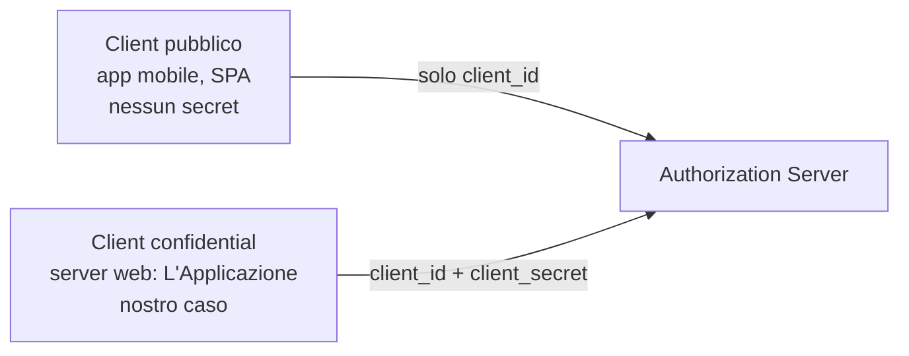
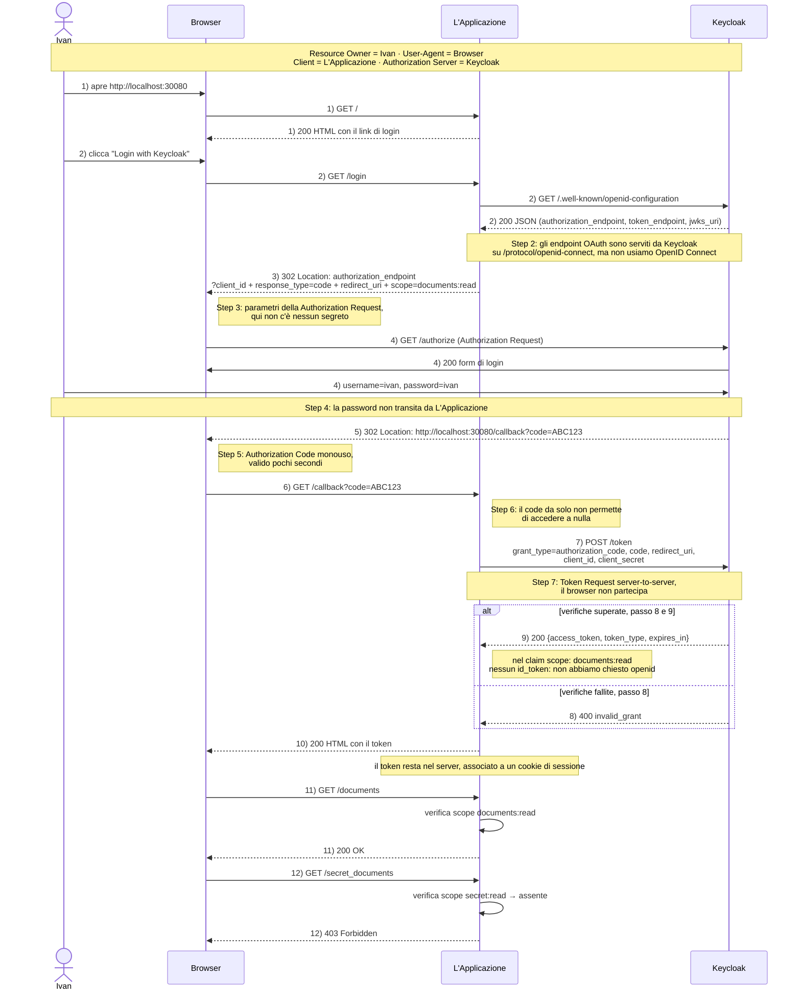
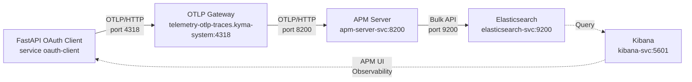

# 1 — Introduzione a OAuth 2.0

Questo documento introduce ad alto livello il processo di autorizzazione OAuth 2.0, per capire *chi* fa cosa e *quali dati* passano tra le entità.

---

# 2 — Il framework usato: FastAPI

**FastAPI** è un framework moderno e veloce per realizzare applicazioni web in Python, principalmente API REST. È progettato per essere facile da usare, con validazione automatica dei dati, documentazione interattiva (Swagger/OpenAPI) e prestazioni elevate.

Esempio minimale di `main.py`:

```python
from fastapi import FastAPI

app = FastAPI()


@app.get("/")
def read_root():
    return {"Hello": "World"}
```

Il codice qui sopra fa questo:
- `from fastapi import FastAPI` — importa la classe principale del framework.
- `app = FastAPI()` — crea l'istanza dell'applicazione.
- `@app.get("/")` — decoratore che associa la funzione alla route `GET /`.
- `def read_root():` — definisce la funzione handler per la route.
- `return {"Hello": "World"}` — restituisce un JSON; FastAPI lo serializza automaticamente.

Per eseguire l'applicazione con `uv`:
```bash
uv run uvicorn main:app --reload
```

---

# 3 — L'Identity Manager usato: KeyCloak

Perché tutto il processo di autorizzazione di OAuth vada a buon fine, bisogna prima fare in modo che KeyCloak conosca l'esistenza dell'Applicazione configurandone i dati. Il client è registrato in Keycloak con i seguenti parametri:

* **`client_id`** — identificativo pubblico del client, per esempio `demo-client`. Va nell'Authorization Request, il browser può vederlo.
* **`client_secret`** — segreto condiviso con Keycloak, noto solo all'Applicazione e a Keycloak. Va nel Token Request.
* **`redirect_uri`** — URI di callback dove Keycloak rimanda il browser dopo l'autenticazione, per esempio `http://localhost:30080/callback`. Deve corrispondere **esattamente** a quella registrata in Keycloak.
* **`response_type=code`** — seleziona l'Authorization Code Flow.
* **`scope`** — elenco degli scope richiesti, per esempio `documents:read`.

### Realm in Keycloak

Un **realm** in Keycloak è un contenitore logico isolato che raccoglie utenti, client, ruoli, scope e configurazioni. Ogni realm è indipendente: gli utenti di un realm non vedono quelli di un altro, e i client configurati in un realm possono autenticarsi solo contro quel realm. Nel laboratorio il realm si chiama `oauth-lab` e contiene tutto il necessario per la demo: l'utente `ivan`, il client `demo-client` e gli scope custom.

### Scope in Keycloak

Uno **scope** in Keycloak rappresenta un permesso o un diritto di accesso. Non è un ruolo utente, ma una *capacità* che il token porta con sé. La sintassi usata nel laboratorio è `risorsa:azione`, per esempio `documents:read` significa "permesso di leggere i documenti". Questa convenzione `resource:action` è una chiave auto-documentante.

Nel laboratorio vengono definiti due **client scope** custom nel realm `oauth-lab`:

```
documents:read
secret:read
```

La loro collocazione nel client è volutamente diversa:

```
documents:read → defaultClientScopes  (concesso sempre)
secret:read    → optionalClientScopes (concesso solo se richiesto)
```

Di conseguenza:
- il client può chiedere `scope=documents:read secret:read`;
- `documents:read` viene concesso anche se non richiesto, perché è default;
- `secret:read` viene concesso **solo** se compare esplicitamente nella richiesta.

### Cosa ne fa l'Applicazione

Quando l'Applicazione riceve l'Access Token da Keycloak, decodifica il claim `scope` (senza verificare la firma, per scelta didattica) e ottiene l'elenco degli scope concessi, per esempio `["documents:read"]`.

L'Applicazione usa questo elenco per decidere se autorizzare l'accesso alle risorse protette:

```python
SCOPE_PER_RESOURCE = {
    "/documents": "documents:read",
    "/secret_documents": "secret:read",
}
```

Quando arriva una richiesta su `/documents`, l'Applicazione verifica che `documents:read` sia presente negli scope del token: se c'è risponde `200 OK`, altrimenti `403 Forbidden`. Stesso meccanismo per `/secret_documents` con `secret:read`. Il token può essere valido (firma corretta, non scaduto) ma non autorizzare l'accesso se manca lo scope richiesto: **token valido ≠ accesso consentito**.

---

# 4. Il problema che OAuth risolve

Un'applicazione vuole accedere ai dati di un utente (Ivan) che stanno su un altro sistema (Keycloak).

L'approccio naïve sarebbe chiedere a Ivan le sue credenziali:

```text
L'Applicazione chiede username e password
        ↓
L'Applicazione usa le credenziali di Ivan per parlare con Keycloak
        ↓
L'Applicazione vede e può salvare la password di Ivan
```

OAuth 2.0 risolve il problema con la **delega**: Ivan autorizza esplicitamente l'Applicazione ad agire per conto suo, e l'Applicazione riceve un **token** al posto della password.

```text
L'Applicazione non vede mai la password di Ivan
        ↓
Ivan inserisce la password solo nella pagina di Keycloak
        ↓
L'Applicazione riceve un token limitato a quanto Ivan ha consentito
```

> Principio chiave: **il client non deve conoscere la password dell'utente.**

---

# 5. Gli attori

Quattro entità, con ruoli distinti:

| Attore | Nel laboratorio | Ruolo |
|---|---|---|
| **Resource Owner** | Ivan | Il proprietario dei dati. È lui che autorizza. |
| **Client** | L'Applicazione (`demo-client`) | L'app che chiede l'accesso. Ha credenziali proprie. |
| **Authorization Server** | Keycloak (realm `oauth-lab`) | Autentica Ivan, rilascia i token. |
| **User-Agent** | Browser | Trasporta le richieste e i redirect. Non decide nulla. |

---

# 6. I dati che viaggiano e gli endpoint che li scambiano

OAuth 2.0 non scambia un solo token né usa una solo endpoint, ma vengono scambati questi codici:

| Dato | Chi lo vede | A cosa serve | Nel laboratorio | Durata |
|---|---|---|---|---|
| **Authorization Code** | transita dal browser | Ottenere i token. Monouso. | sì | secondi |
| **Access Token** | resta sul server | Autorizzare l'accesso alle risorse | sì | minuti |
| **ID Token** (OpenID Connect) | resta sul server | Chi è l'utente che ha fatto login | **no** | minuti |

...e vengono usati questi due endpoint:

| Endpoint | Metodo | Chi lo chiama | Quando |
|---|---|---|---|
| **Authorization Endpoint** | `GET` | il browser | All'avvio del login, con un redirect |
| **Token Endpoint** | `POST` | il server del client | Dopo il callback, chiamata server-to-server |

> L'`Authorization Endpoint` viene raggiunto dal **browser**.
> Il `Token Endpoint` viene raggiunto **solo dal server**.
> Questo è il cuore del Authorization Code Flow.

I due endpoint non sono URL noti a priori: il client li scopre leggendo il **discovery document** dell'Authorization Server, cioè `/.well-known/openid-configuration`, un JSON che elenca tutti gli URL del server (`authorization_endpoint`, `token_endpoint`, `jwks_uri`, …).

## Le credenziali del client

Il client non ha le credenziali di Ivan, ma ha **credenziali proprie**, che lo identificano verso Keycloak:

* **`client_id`** — identificativo pubblico del client, per esempio `demo-client`. Va nell'Authorization Request, il browser può vederlo.
* **`client_secret`** — segreto condiviso con Keycloak, noto solo all'Applicazione e a Keycloak. Va nel Token Request.

Da questi due valori dipende come il client viene autenticato:



* **Client pubblico**: l'applicazione gira su un dispositivo dell'utente, quindi non c'è modo di nascondere un segreto: chiunque potrebbe leggere qualunque cosa ci mettiamo dentro. Si dice *pubblico* per questa ragione.
* **Client confidential**: l'applicazione gira su un server, il secret resta lì e il browser non lo vede mai. È il caso di questo laboratorio.

Il client confidential si autentica con `client_id` + `client_secret` nel Token Request; il client pubblico non ha nulla da mostrare.

> **PKCE** è l'estensione pensata per i client pubblici: permette a chi non ha un `client_secret` condiviso con Keycloak di dimostrare comunque che è possessore del codice ricevuto. Si cita solo come termine di confronto — in questo laboratorio il client è confidential e l'estensione **non viene implementata**.

Il motivo dell'esistenza del PKCE è che, in generale, **il segreto non deve transitare mai dal browser**.

---

# 7. Authorization Code Flow completo

Lo schema mostra gli attori, le fasi e i dati scambiati. La numerazione dei flussi coincide con quella usata nei commenti di `main.py`; la tabella sotto spiega ogni chiamata.



## Cosa fa ogni chiamata

| Step | Da → a | Chiamata | Cosa fa |
|---|---|---|---|
| 1 | Ivan → Browser | apre `http://localhost:30080` | L'utente avvia il flusso dal lato browser. |
| 1 | Browser → L'Applicazione | `GET /` | L'Applicazione restituisce la pagina con il link di login. Non chiama Keycloak: l'utente non è ancora autenticato e non esiste alcun token. |
| 2 | Browser → L'Applicazione | `GET /login` | L'utente chiede di iniziare il login. L'Applicazione deve sapere dove si trova Keycloak, ma non lo sa a priori. |
| 2 | L'Applicazione → Keycloak | `GET /.well-known/openid-configuration` | **Discovery.** L'Applicazione legge il documento JSON che elenca gli URL del server e recupera `authorization_endpoint` e `token_endpoint`. In Keycloak il percorso include il realm: `/realms/oauth-lab/.well-known/openid-configuration`. |
| 3 | L'Applicazione → Browser | `302 Location: …?client_id&response_type=code&redirect_uri&scope` | L'Applicazione **costruisce** la Authorization Request ma non la esegue: rimanda il browser con un 302. `response_type=code` seleziona il Authorization Code Flow, `redirect_uri` dice a Keycloak dove tornare, `scope` delimita cosa si chiede. |
| 4 | Browser → Keycloak | `GET /authorize` + `?` parametri | Il browser esegue davvero la Authorization Request. Keycloak verifica che il `client_id` sia registrato e che la `redirect_uri` corrisponda, poi mostra il form di login. |
| 4 | Keycloak → Browser | `200` form di login | Keycloak autentica l'utente. Le credenziali che Ivan inserisce arrivano **solo** a Keycloak: L'Applicazione non le vede e non le memorizza, ed è il principio della delega. |
| 5 | Keycloak → Browser | `302 Location: …/callback?code=ABC123` | Keycloak genera un Authorization Code e lo consegna al browser, che lo inoltrerà alla `redirect_uri` dichiarata allo step 3. Il codice è breve e monouso. |
| 6 | Browser → L'Applicazione | `GET /callback?code=ABC123` | Il browser trasporta il code al client. Il code, da solo, **non** serve ad accedere a nulla: serve solo a ottenere i token. |
| 7 | L'Applicazione → Keycloak | `POST /token` | **Token Request.** L'Applicazione scambia il code con i token allegando `grant_type=authorization_code`, il `code`, la stessa `redirect_uri` e le credenziali del client (`client_id` + `client_secret`). È una chiamata server-to-server: il browser non partecipa ed è l'unico modo per un confidential client di dimostrare la propria identità. |
| 8 | Keycloak (verifica) | — | Prima di rispondere Keycloak controlla che il `client_secret` sia corretto, che il code non sia scaduto né già usato e che la `redirect_uri` corrisponda a quella dello step 3. Se un controllo fallisce risponde `400 invalid_grant` e non emette nulla. |
| 9 | Keycloak → L'Applicazione | `200 {access_token, token_type, expires_in}` | **Token Response.** Le verifiche sono passate, quindi Keycloak emette l'Access Token e **invalida il code**, che non può essere riutilizzato. Nel claim `scope` compaiono gli scope concessi. |
| 10 | L'Applicazione → Browser | `200 HTML` | L'Applicazione riceve l'Access Token e mostra il risultato. È una scelta della demo per rendere visibile il token: in un'app reale non verrebbe stampato in pagina, bensì conservato **server-side** e legato a un cookie di sessione. |
| 11 | Browser → L'Applicazione | `GET /documents` | **Accesso alla risorsa protetta.** L'Applicazione recupera il token dalla sessione, legge il claim `scope` e lo confronta con `documents:read`, che è presente: risponde `200`. |
| 12 | Browser → L'Applicazione | `GET /secret_documents` | Stessa procedura, ma la risorsa richiede `secret:read`, che nel token non c'è: L'Applicazione risponde `403 Forbidden`. Il token era valido, il permesso no. |

---

### Dettaglio degli step (1–10)

**Step 1 — Ivan apre L'Applicazione**

Ivan apre:
```
http://localhost:30080
```

L'Applicazione restituisce una pagina contenente:
```
OAuth 2.0 Lab
Login with Keycloak
```

In questo momento Ivan non è ancora autenticato.

---

**Step 2 — Ivan clicca Login**

Il Browser effettua:
```
GET /login
```
verso L'Applicazione.

L'Applicazione deve conoscere gli endpoint OAuth di Keycloak.

Per questo utilizza il discovery endpoint:
```
http://keycloak.oauth-lab.svc.cluster.local:8080/realms/oauth-lab/.well-known/openid-configuration
```

Keycloak restituisce un documento JSON contenente informazioni sugli endpoint, tra cui:
```
authorization_endpoint
token_endpoint
```

L'Applicazione utilizza l'`authorization_endpoint`.

---

**Step 3 — L'Applicazione prepara l'Authorization Request**

L'Applicazione costruisce una richiesta equivalente a:
```
GET /realms/oauth-lab/protocol/openid-connect/auth
```
con:
```
client_id=demo-client
response_type=code
redirect_uri=http://localhost:30080/callback
scope=documents:read
```

L'Applicazione non esegue direttamente questa richiesta. Risponde al Browser con un HTTP redirect.

Il percorso diventa:
```
Browser
   │
   │ GET /login
   ▼
L'Applicazione
   │
   │ HTTP 302 Redirect
   ▼
Browser
   │
   │ Authorization Request
   ▼
Keycloak
```

---

**Step 4 — Keycloak autentica Ivan**

Keycloak riceve la richiesta di autorizzazione. Verifica il client:
```
client_id = demo-client
```
e mostra la pagina di login.

Ivan inserisce:
```
username = ivan
password = ivan
```

Il percorso è:
```
Browser
   │
   │ username + password
   ▼
Keycloak
```

La password non passa attraverso L'Applicazione.

Questo è un concetto importante di OAuth:
> Il client non deve conoscere la password dell'utente.

---

**Step 5 — Keycloak genera l'Authorization Code**

Dopo l'autenticazione di Ivan, Keycloak genera un:
```
Authorization Code
```
Il code è: temporaneo; associato alla richiesta di autorizzazione; utilizzato per ottenere i token.

Keycloak **non restituisce direttamente l'Access Token al Browser**. Invece esegue un redirect verso:
```
http://localhost:30080/callback
```
aggiungendo:
```
?code=...
```

Concettualmente:
```
Keycloak
   │
   │ HTTP 302
   │
   │ Location:
   │ http://localhost:30080/callback?code=ABC123
   ▼
Browser
```

---

**Step 6 — Il Browser porta il code a L'Applicazione**

Il Browser segue il redirect. L'Applicazione riceve:
```
GET /callback?code=ABC123
```
Il dato importante è:
```
code=ABC123
```
Questo è l'Authorization Code. Il Browser ha quindi svolto il compito di trasportare il code da Keycloak alla Redirect URI di L'Applicazione.

---

**Step 7 — L'Applicazione effettua il Token Request**

L'Applicazione **non utilizza il code come Access Token**. Effettua invece una nuova richiesta direttamente verso Keycloak.

La comunicazione è:
```
L'Applicazione
   │
   │ POST /token
   ▼
Keycloak
```

La richiesta contiene concettualmente:
```
grant_type=authorization_code
code=ABC123
redirect_uri=http://localhost:30080/callback
client_id=demo-client
client_secret=demo-client-secret
```

Questo è un passaggio fondamentale:
> Il Token Request non passa attraverso il Browser.

È una comunicazione:
```
L'Applicazione → Keycloak
```

---

**Step 8 — Keycloak verifica il Token Request**

Keycloak riceve il Token Request. Verifica:
```
client_id
client_secret
authorization code
redirect_uri
```
Se tutto è valido, Keycloak emette il Token Response.

---

**Step 9 — Keycloak restituisce l'Access Token**

Keycloak risponde a L'Applicazione con una risposta JSON.

Concettualmente:
```json
{
  "access_token": "...",
  "token_type": "Bearer",
  "expires_in": 300
}
```

La risposta reale può contenere ulteriori proprietà. Il dato principale è:
```
access_token
```

La comunicazione è:
```
Keycloak
   │
   │ Token Response
   │
   │ access_token
   │ token_type
   │ expires_in
   ▼
L'Applicazione
```

---

**Step 10 — L'Applicazione riceve l'Access Token**

L'Applicazione riceve l'Access Token e lo decodifica per leggerne il claim `scope`. Per rendere visibile il risultato della demo, la nostra implementazione mostra il token e gli scope nella pagina HTML. Questo comportamento è stato scelto esclusivamente per il laboratorio.

In una applicazione reale non dovremmo mostrare l'Access Token direttamente nella pagina. Il token non viene restituito al Browser: viene conservato **lato server**, associato a un cookie di sessione (`sid`). Il Browser non deve poter leggere il token, perché non è destinato a lui.

Da questo momento in poi L'Applicazione agisce anche da Resource Server e usa il token per autorizzare l'accesso alle risorse protette.

---

# 8. OpenTelemetry con Kyma Telemetry Manager

## Cosa fa

Le richieste HTTP gestite da FastAPI e le chiamate uscenti verso Keycloak vengono tracciate automaticamente come **span** OpenTelemetry dall'instrumentazione iniettata dall'OpenTelemetry Operator. In Kibana è possibile ricostruire il flusso di autorizzazione OAuth 2.0:

```text
GET /
    → http.server.request
GET /login
    → http.server.request
    └── httpx GET /.well-known/openid-configuration
GET /callback
    → http.server.request
    └── httpx POST /token
GET /documents
    → http.server.request
GET /secret_documents
    → http.server.request
```

Gli span contengono gli attributi standard OpenTelemetry (es. `http.method`, `http.route`, `http.url`, `http.status_code`).

## Architettura Telemetria



### Componenti Kubernetes

| Componente | File | Ruolo |
|---|---|---|
| **Elasticsearch** | `k8s/telemetria/elastic.yaml` | Data store per trace, metriche, log |
| **APM Server** | `k8s/telemetria/elastic.yaml` | Riceve trace OTLP su porta 8200, invia a Elasticsearch |
| **Kibana** | `k8s/telemetria/elastic.yaml` | UI per visualizzare trace (APM → Services) - NodePort 30082 |
| **Kyma Telemetry Manager** | `k8s/telemetria/tracepipeline.yaml` | Crea OTLP Gateway, gestisce pipeline trace |

**TracePipeline** (`k8s/telemetria/tracepipeline.yaml`):
```yaml
apiVersion: telemetry.kyma-project.io/v1beta1
kind: TracePipeline
metadata:
  name: apm-server
spec:
  output:
    otlp:
      protocol: http
      endpoint:
        value: http://apm-server-svc.default.svc.cluster.local:8200
```

Il Telemetry Manager crea automaticamente il Service `telemetry-otlp-traces` nel namespace `kyma-system` sulle porte 4317 (gRPC) e 4318 (HTTP).

### Risorsa Instrumentation (OpenTelemetry Operator)

L'OpenTelemetry Operator inietta l'auto-instrumentazione Python nei pod dell'applicazione. L'injection si attiva in due fasi:

**1. Annotazione sul deployment** (`k8s/app/deployment.yaml`):

```yaml
spec:
  template:
    metadata:
      annotations:
        instrumentation.opentelemetry.io/inject-python: "true"
```

Questa annotazione dice all'operatore di iniettare un init-container (`opentelemetry-auto-instrumentation-python`) nel pod all'avvio.

**2. Risorsa `Instrumentation`** (`k8s/telemetria/instrumentation.yaml`):

```yaml
apiVersion: opentelemetry.io/v1alpha1
kind: Instrumentation
metadata:
  name: oauth-client
  namespace: oauth-lab
spec:
  exporter:
    endpoint: http://telemetry-otlp-traces.kyma-system.svc.cluster.local:4318
  propagators:
    - tracecontext
    - baggage
  sampler:
    type: always_on
  python:
    env:
      - name: OTEL_EXPORTER_OTLP_PROTOCOL
        value: http/protobuf
      - name: OTEL_TRACES_EXPORTER
        value: otlp
      - name: OTEL_METRICS_EXPORTER
        value: none
      - name: OTEL_LOGS_EXPORTER
        value: none
      - name: OTEL_SERVICE_NAME
        value: oauth-client
```

La risorsa `Instrumentation` configura:
- **`exporter.endpoint`**: il gateway OTLP del Telemetry Manager di Kyma (`telemetry-otlp-traces.kyma-system:4318`), creato dalla `TracePipeline`.
- **`sampler.type: always_on`**: tutte le tracce vengono esportate (utile in ambiente di laboratorio).
- **`python.env`**: variabili d'ambiente OpenTelemetry per l'agente Python (protocollo, exporter, nome servizio).

A ogni avvio del pod, l'operatore inietta l'agente Python che genera automaticamente span per le richieste FastAPI in entrata e le chiamate `httpx` in uscita verso Keycloak. Le trace fluiscono poi verso l'APM Server e infine a Kibana.

### Accesso ai Servizi (NodePort, nessun port-forward)

| Servizio | URL | Note |
|---|---|---|
| **OAuth Client** | http://localhost:30080 | Applicazione FastAPI |
| **Keycloak** | http://localhost:30081 | Admin: admin/admin |
| **Kibana** | http://localhost:30082 | Observability → APM → Services |

### Visualizzazione in Kibana

1. Apri **http://localhost:30082** (Kibana via NodePort)
2. Vai in **Observability → APM → Services**
3. Seleziona **`oauth-client`** → tab **Transactions** o **Traces**
4. Clicca una transazione → vedrai la **waterfall view** con:
   - Span FastAPI (richieste in entrata)
   - Span httpx (chiamate a Keycloak)
   - Timing, parent/child relationships, errori

### Deploy Completo

```bash
# Esegue tutto: cluster, Keycloak, Elastic stack, Telemetry Manager, OAuth Client
./installa_cluster.sh
```

Lo script applica le risorse **in ordine** e attende che ciascuna sia pronta prima di passare alla successiva. Alla fine tutti i servizi sono accessibili via NodePort senza port-forward.